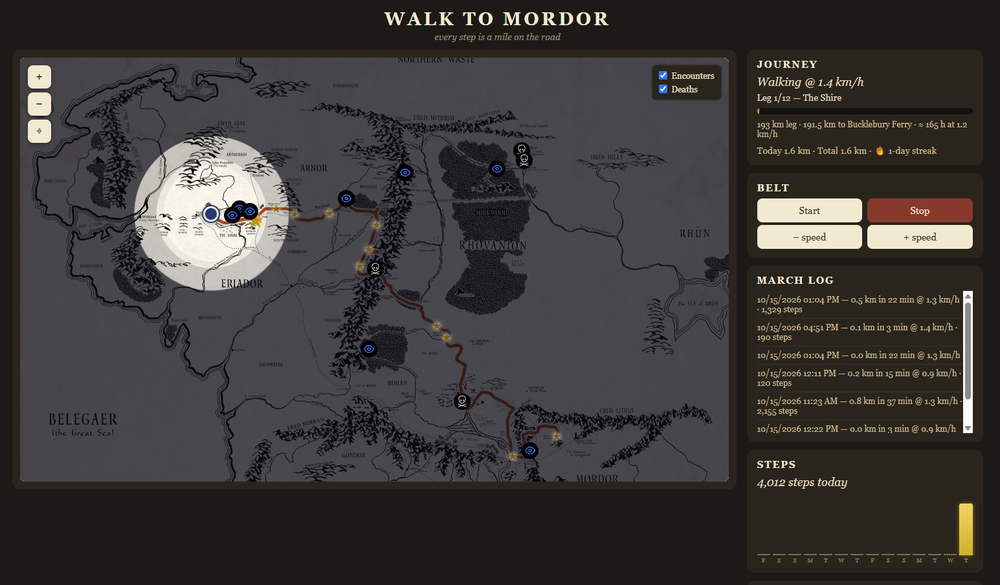
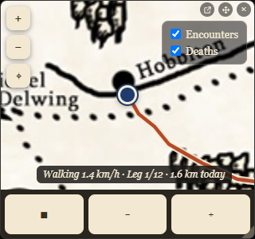
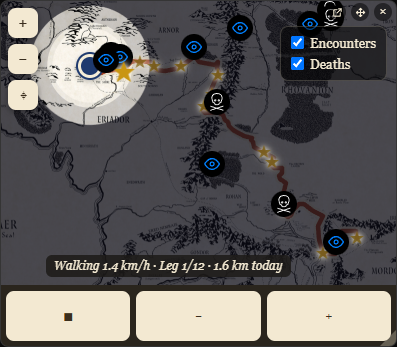
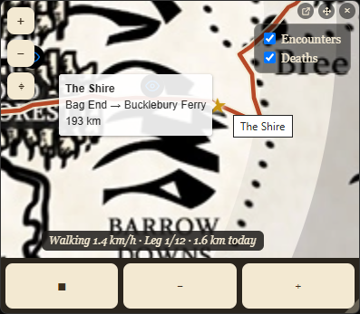

# Walk to Mordor

Turn an under-desk walking pad into a journey across Middle-earth.

Walk in real life, travel in Middle-earth. A background daemon connects to your walking pad over Bluetooth, logs every step to a local database, and serves a live dashboard with your party token moving across the actual Middle-earth map.



## What it does

- **Live map**: Your position on the road from Bag End to Mount Doom, with fog-of-war lifting as you walk
- **Floating widget**: Always-on-top mini map with belt controls (Start/Stop/speed)
- **Belt controls**: Start, stop, and adjust speed from the dashboard, widget, or CLI
- **March tracking**: Every walk is logged with distance, duration, steps, calories, avg speed
- **Daily nudge**: Windows notification if you haven't walked yet today
- **Full installer**: One-click Inno Setup installer with auto-start on login

### Widget



The floating widget stays on top while you work. Drag it by the hand control, resize from the corner, and control the belt without switching windows.



Toggleable Encounters and Deaths overlays mark points of interest along the route. Click any marker for details.



## Quick start (Windows)

**Option 1: Installer** (recommended)

Download `WalkToMordorSetup-*.exe` from [Releases](https://github.com/Ahuge/walk-to-mordor/releases) and run it. It installs the daemon, widget, and daily nudge, all auto-starting at login.

**Option 2: From source**

```powershell
pip install bleak pywebview pyinstaller

# Install the daemon + widget as logon tasks:
python tools/install_windows.py --widget --nudge

# Or run the daemon in the foreground to test:
python bridge/daemon.py
```

Then open http://127.0.0.1:8471/ in your browser, or launch the widget:
```powershell
python tools/build_widget_exe.py  # builds dist/WalkToMordorWidget.exe
```

**Bluetooth note:** Power-cycle the pad (it advertises BLE only briefly after power-on). Keep the UREVO phone app closed — the pad takes one BLE connection at a time.

## How it works

```
Walking pad --BLE FTMS--> Daemon --SQLite--> walks.db
                              |
                         HTTP API :8471
                          /       \
                    Dashboard   Widget (pywebview)
```

- **Daemon** (`bridge/daemon.py`): Auto-connects to the pad via Bluetooth FTMS, logs 1/sec readings (speed, distance, incline, calories, steps) to SQLite, serves the HTTP API and dashboard.
- **Marches**: A march starts when the belt moves, ends after 60s idle or on disconnect. Saved to the `marches` table with full stats.
- **API** (`127.0.0.1:8471`): `GET /api/stats`, `POST /api/commands` (start/stop/speed/incline), `GET /api/route`, `GET /api/marches`, `GET /api/log`. Loopback callers need no credentials; remote callers must send `Authorization: Bearer <token>` using the token in `%LOCALAPPDATA%\walk-to-mordor\api.token` (created at daemon startup).
- **Dashboard** (`ui/dashboard.html`): Leaflet map with the journey route, live token, fog-of-war, leg progress, belt controls, march log, steps graph, and an Advanced page (`/advanced`) with BLE diagnostics.
- **Widget** (`ui/widget.py`): Borderless always-on-top pywebview window showing the map in compact mode.

## Belt controls

From the dashboard, widget, or CLI:

```powershell
python treadmill/control.py start          # 3-2-1 countdown, then belt starts
python treadmill/control.py stop           # stop the belt
python treadmill/control.py speed 4.0      # set target speed (km/h)
python treadmill/control.py incline 3      # set target incline (%)
```

**Safety:** The CLI counts down 3-2-1 before `start`. `stop` always works and clears queued targets. Speed/incline clamp to the pad's reported range.

## Project layout

```
bridge/
  daemon.py      background BLE bridge + HTTP API + march tracker
  store.py       SQLite storage (shared DB path)
  stats.py       live stats snapshot / --watch
  rebuild.py     recover march summaries from raw readings
treadmill/
  probe.py       scan for the pad, dump BLE services
  reader.py      live 1/sec FTMS stream (read-only)
  control.py     belt control CLI (via daemon API)
ui/
  dashboard.html full dashboard (map, controls, stats)
  advanced.html  BLE diagnostics + log viewer
  widget.py      floating always-on-top widget
  minimap.py     legacy tkinter minimap
tools/
  install_windows.py   logon tasks (daemon/widget/nudge)
  build_widget_exe.py  PyInstaller for the widget
  build_daemon_exe.py  PyInstaller for the daemon
  build_installer.py   full Inno Setup build
  nudge.py             daily walk reminder
installer/
  walk-to-mordor.iss   Inno Setup script
packs/
  lotr/          Pack 1: Walk to Mordor (route, encounters, art)
docs/
  protocol.md    FTMS byte map
  game-design.md full game design (engine + content packs)
```

## Map credit

Map: Yohann Bethoule / [middleearthmap.app](https://middleearthmap.app/) (base map by lotrproject.com) — used with the author's explicit permission. Assets vendored under `packs/lotr/art/`.

## Technical notes

- UREVO SpaceWalk pads expose standard Bluetooth [FTMS](https://www.bluetooth.com/specifications/specs/fitness-machine-service-1-0/) (`0x1826`). Byte map in `docs/protocol.md`.
- Storage: `%LOCALAPPDATA%\walk-to-mordor\walks.db` (log: `daemon.log` alongside).
- The pad streams only the current session over BLE — `walks.db` is the historian.
- API binds `0.0.0.0:8471`; keep it firewalled to your LAN. Non-loopback requests require the bearer token, and the daemon refuses to start twice (lock file in the data directory).
- The logon tasks restart after a failure, run on battery, and have no 72-hour limit. The installer applies these; for source installs, `tools/install_windows.py` does it, or run `powershell -ExecutionPolicy Bypass -File installer\harden_tasks.ps1`.
